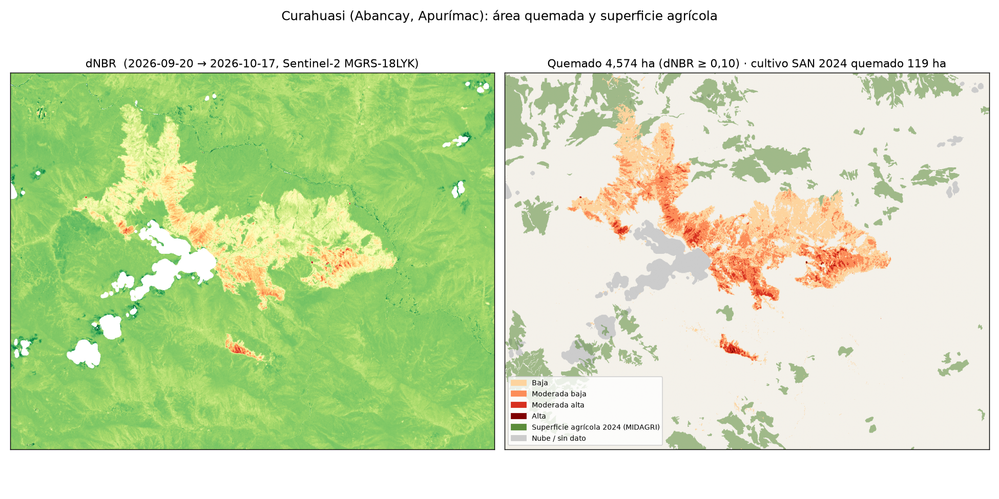

# ¿Qué se quemó y qué se puede quemar? Cultivos frente a los incendios del Perú, octubre 2026

Tarea de Ciencia de Datos con Python (Prof. Alexander Quispe, Universidad del Pacífico) · reto **C (¿qué se quemó?)**, ampliado con la Superficie Agrícola Nacional 2024 del MIDAGRI.

**Tablero web:** https://claude.ai/artifact/8o1axzxDUpRPo4XTg8w33y



## Pregunta

1. **¿Qué se quemó?** ¿Cuánta superficie agrícola tocan los incendios, y cuánto de ella *ve* ESA WorldCover?
2. **¿Qué se puede quemar?** ¿Cuánta superficie agrícola hay a ≤ 1 y ≤ 5 km de los incendios activos?

## Tres hallazgos

1. **WorldCover casi no ve la agricultura que arde.** Según el monitor del profesor (WorldCover), solo el **1 %** de los focos de 7 días cae en "Cultivo". Con la Superficie Agrícola Nacional 2024 del MIDAGRI, el **22,4 %** de los 9 949 focos del 14 al 21 de octubre cae en superficie agrícola, unas **22 veces más**. Los incendios que tocan superficie agrícola están clasificados en el monitor sobre todo como "Bosque" (850) y "Pastizal" (235), y solo 29 como "Cultivo".
2. **Curahuasi: 4 574 ha quemadas (dNBR ≥ 0,10); 1 677 ha con dNBR ≥ 0,27**, cerca de las 1 786 ha del profesor con el mismo umbral (−6 %). Dentro del área quemada hay **119 ha de superficie agrícola**; WorldCover solo marca **14 ha** de "Cultivo" y clasifica la mayoría de esas parcelas como pastizal (67 ha) o bosque (32 ha). El 66 % de lo quemado es pastizal según WorldCover. Casi toda esa superficie agrícola (116 de 119 ha) ardió con severidad baja.
3. **Lo que se puede quemar:** hay **321 378 ha** de superficie agrícola a ≤ 5 km de los 181 incendios activos (con focos en las últimas 24 h). Los departamentos con más son Ucayali (79 894 ha), Madre de Dios (39 973) y Junín (32 749). En Curahuasi quedan **1 435 ha** agrícolas sin quemar a ≤ 1 km de la cicatriz (12 veces lo quemado) y **4 517 ha** a ≤ 5 km (distancia euclidiana, dentro del recuadro analizado).

## Datos y fechas

| Dato | Fuente | Fechas |
|---|---|---|
| Focos de calor VIIRS (S-NPP, NOAA-20, NOAA-21) | NASA FIRMS, CSV «South America 7d» | 14 al 21 oct 2026, corte 21 oct 19:19 UTC |
| Superficie agrícola | MIDAGRI, Superficie Agrícola Nacional 2024 (interpretación de imágenes Planet y Google) | 2024 |
| Imágenes | Sentinel-2 L2A, catálogo STAC de Earth Search (AWS) | antes 20 sep 2026 (100 % válido en la zona), después 17 oct 2026 (97 % válido), tile 18LYK |
| Cobertura del suelo | ESA WorldCover 2021, 10 m | 2021 |
| Límites distritales | juaneladio/peru-geojson | — |
| Incendios de referencia | Monitor de incendios del profesor (corte 17 oct 2026) | — |

## Método

1. **Incendios** (`src/01_incendios_cultivo.py`): focos sin confianza baja y sin los que están a 3 km de los volcanes activos; los focos a ≤ 1 km y ≤ 48 h se unen en un incendio (la misma definición del monitor). Huella = unión de píxeles de 375 m. Se cruza con la SAN 2024: focos dentro, hectáreas en la huella y en anillos de 1 y 5 km.
2. **Área quemada** (`src/02_dnbr_curahuasi.py`): reutiliza el método de descarga sin GEE de mi proyecto de clasificación de cultivos. Se lee solo la ventana de la zona y se elige cada imagen por el **% de píxeles válidos en la zona según la capa SCL**, no por la nubosidad de la escena. Ejemplo: la escena 18LYL del 17 oct tenía 55 % de nubes, pero 95 % válido en la zona. NBR = (B8A−B12)/(B8A+B12); dNBR y RBR (Parks et al. 2014). Máscara: SCL (nube, sombra, cirro, agua) + MNDWI > 0. **dNBR sembrado con focos:** cuenta cada mancha continua de dNBR ≥ 0,10 que toque la zona a ≤ 1 km de un foco. Severidad según Key y Benson (2006).
3. **Qué se quemó:** área quemada × WorldCover (moda a 20 m) y × SAN 2024.
4. **Tablero web** (enlace arriba): visor raster de Curahuasi con capas y umbral de dNBR en vivo; `src/03_raster_web.py` exporta el raster y `data/monitor/index.html` es la página. Versión local: `uv run streamlit run dashboard/app.py`.

Reproducir: `uv sync`, luego `uv run python src/01_incendios_cultivo.py` y `uv run python src/02_dnbr_curahuasi.py`.

## Limitaciones

- **Un foco de calor no es un incendio**, y la huella no es área quemada. Hay fuentes fijas que aún no se excluyen (La Joya y Moquegua tienen huellas grandes sin cultivo cerca).
- **Las nubes esconden el fuego:** 6,7 % de la zona de Curahuasi quedó sin dato.
- **Fechas:** la imagen previa (20 sep) es 16 días anterior al inicio del fuego (6 oct); el secado estacional puede inflar el dNBR bajo (0,10–0,27). Por eso se reporta también el umbral 0,27.
- **SAN 2024 es superficie agrícola**, no cultivo en pie: incluye barbecho y parcelas en descanso. En la selva incluye chacras de roza y quema, donde el fuego es parte del manejo agrícola.
- **WorldCover es de 2021.**
- El "cultivo a 5 km" mide exposición, no daño. Falta sumar el clima (HDW con Open-Meteo) para estimar qué incendios pueden crecer: es el siguiente paso.
- La capa SAN 2024 no se sube al repositorio (714 MB).

## Estructura

```
src/                 scripts (1: incendios × SAN 2024; 2: dNBR Curahuasi; 3: raster para la web)
data/monitor/        página y datos del tablero web
data/processed/      incendios.csv, resúmenes JSON (los .gpkg y .tif no se suben)
outputs/maps/        mapas
dashboard/app.py     tablero Streamlit
```
